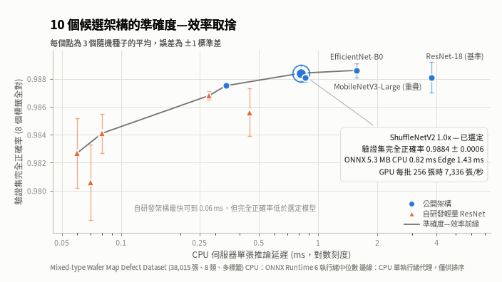

# 晶圓缺陷分類：模型開發

> 語言 : *[English](README.md)*

以公開的晶圓圖資料集 MixedWM38 開發多標籤缺陷分類模型，針對雲端 GPU、CPU 伺服器、邊緣裝置三種部署情境
選出最合適的模型，並交付可以直接部署的 ONNX 模型。本專案是後續「推論部署」專案的前半部。


## 簡短摘要

**做了什麼：** 晶圓測試後會產生一張「晶圓圖」，標示每個晶粒是良品還是不良品；不良晶粒的分佈型態 (例如集中在
中央、沿著邊緣、呈現刮痕)能指出製程哪裡出了問題。本專案訓練模型自動辨識 8 種缺陷型態，一張晶圓圖可能同時
有好幾種。

**成果：**
- 在完全沒有參與訓練與選擇的 3,700 張測試晶圓圖上，**98.76% 的晶圓圖所有缺陷都判斷正確**
- 交付的模型只有 1.26M 個參數、5.3 MB，在一般 CPU 上判斷一張晶圓圖只需 **0.82 毫秒**
- **一個模型同時滿足三種部署情境**，降低後續的維護成本
- 輸出內容包含模型檔、使用規格、效能報告與完整的追溯資訊，部署端可以直接使用輸出結果



*MobileNetV3-Large 與選定模型重疊：完全正確率在雜訊範圍內相同，CPU 延遲也幾乎一樣。*

**展示內容：**
| 項目 | 具體表現 |
|---|---|
| 資料品質分析 | 在建模前發現重複影像造成分數高估，以及資料集文件沒有紀錄的異常數值，並完成修正 |
| 錯誤分析與問題洞察 | 證明剩下的錯誤主要來自標籤本身的模糊，而不是模型能力不足，因此把重心從準確度轉向效率 |
| 實驗設計與統計嚴謹度 | 多次重複實驗、量化雜訊、信賴區間、成對比較；選擇模型的規則在看到結果之前就已經記錄 |
| 模型開發 | 比較五種現成架構、以 Optuna 進行多目標超參數搜尋、在 GPU 與 CPU 上實測速度 |
| 可解釋性分析 | 以 Grad-CAM 檢驗模型的判斷依據，搭配對照組，並在分析前寫下所有可能的結果 |
| MLOps 與工程品質 | MLflow 實驗追蹤與模型註冊、GitHub Actions 持續整合、超過 300 個自動化測試、可追溯的資料與程式版本、ONNX 匯出與驗證、model card |

**專案缺陷：** 專案中有幾個沒有成功的嘗試與規則上的缺陷，例如自訂的精簡模型速度最快但不夠準確、閾值
調整沒有改善結果，這些都照實記錄在報告中。

**技術棧：** Python 3.12、PyTorch、torchvision、scikit-learn、Optuna、MLflow、ONNX、ONNX Runtime、pydantic、pytest、ruff、mypy、pre-commit、GitHub Actions、conda、pip-tools

[](https://github.com/poloH23/wafer-defect-model-dev/actions/workflows/ci.yml)
[](https://github.com/poloH23/wafer-defect-model-dev/actions/workflows/audit.yml)
[](https://opensource.org/licenses/Apache-2.0)


## 資料品質發現

在任何建模之前，對資料集做了完整的檢查，發現兩個問題：

- **重複的影像：** 有 1,023 組完全相同的影像，共 2,047 張，標籤都一致。其中 1,000 張重複來自 Center、
  Edge_Loc、Scratch 組合的完整第二份副本，另外 24 張在 Random 與 Near_Full 類別中。在最初的切分 `v1` 中，
  有 157 張驗證集與 174 張測試集影像在訓練集裡有完全相同的副本，使分數被高估。切分 `v2` 在分割前先排除
  1,024 張重複影像，作為之後所有實驗的基礎；`v1` 保留下來作為對照。
- **未記載的像素值：** 資料集文件說明像素值只有 0、1、2，但有 105 張影像中的 214 個像素值為 3，全部位於
  Random (97 張)與 Near_Full (8 張)類別。處理方式是在記憶體中以鄰近像素的眾數補值 (194 個補為不良、
  20 個補為良品)，原始資料檔不做任何修改。


## 方法摘要

完整的論述，以及每個設計決策背後的理由，請見 [docs/zh-TW/methodology.md](docs/zh-TW/methodology.md)：

- **先確保評估方式可信：** 所有決策只使用驗證集；測試集只在最後評估一次。每次訓練都完整跑完 cosine 排程
  並保留最後一個 epoch 的模型，每個設定以 3 個隨機種子比較。先前保留最佳 epoch 並提前停止的做法，會讓分數
  偏高，訓練之間的雜訊也大了六倍。準確度指標是誤判的樣本數：macro 平均精確度在約 0.998 就飽和了，已無法
  分出模型的高下。
- **先理解錯誤，再追求改善：** 以規則量測缺陷沿晶圓邊緣分佈的程度，發現最常見的混淆（Edge_Loc 與 Edge_Ring）
  來自與類別定義互相矛盾的標籤：baseline 的每一筆這類錯誤，都落在 Edge_Loc 覆蓋率最高的 4% 之中。準確度
  受限於標籤品質，因此重心轉向效率。
- **模型容量不是瓶頸：** 從 94 到 3,047 MFLOPs 的五個架構，在雜訊範圍內準確度相同，每個架構的學習率都依照
  相同的事先規則選出：
  | 架構 | MFLOPs | 驗證集錯誤數（3 個 seed） |
  |---|---|---|
  | EfficientNet-B0 | 646 | 42.1 ± 2.0 |
  | ShuffleNetV2 1.0x | 250 | 43.1 ± 2.1 |
  | MobileNetV3-Large | 355 | 43.9 ± 1.0 |
  | ResNet-18 | 3,047 | 44.1 ± 4.2 |
  | MobileNetV3-Small | 94 | 46.2 ± 0.2 |
- **運算量不等於速度：** 在 GPU 與 CPU（ONNX Runtime）上的實測顯示，FLOPs 能預測同一架構家族內的 CPU 延遲，
  跨家族則不精確（ResNet 式的卷積每毫秒完成的運算量約為行動裝置架構的兩倍），也無法預測 GPU 延遲：GPU 延遲
  取決於層數，運算量最大的 ResNet-18 在 GPU 上反而比每一個行動裝置架構都快。
- **描繪取捨，再加以確認：** 以 Optuna 對精簡版 ResNet 做多目標搜尋（驗證集錯誤數對 FLOPs，50 個篩選 trial），
  篩選結果顯示準確度一直持平到約 33 MFLOPs。以完整流程確認後推翻了這個結論：精簡版 ResNet 在每個目標上都是
  最快的模型，但在相近的運算量下不如現成架構準確，因此沒有任何一個符合資格。這是一個負面結果，在它影響選擇
  之前就被發現。
- **以對照組解釋模型：** 被選中模型的 Grad-CAM 熱圖，與相同架構、隨機權重的模型比對，而且量測方式在量測
  真實模型之前，先以缺陷位置已知的合成晶圓校正。Edge_Loc 的熱圖起初看似指向缺陷以外的地方；一個事先寫下
  所有可能結果的診斷找出了原因：熱圖標示的是邊緣失效中斷的地方，而這正是區分局部邊緣缺陷與整圈缺陷的證據。
- **選擇規則事先確定：** 三個部署目標各自如何選出模型，細節寫在 [docs/zh-TW/model_selection.md](docs/zh-TW/model_selection.md)，在搜尋與測試評估之前就已 commit，因此選擇方式無法配合結果調整。


## 結果

**交付的模型：ShuffleNetV2 1.0x**，以資料擴增與 3e-3 的學習率從頭訓練，服務全部三個部署目標 (雲端 GPU、
CPU 伺服器、邊緣)。它依照 [模型選擇規則](docs/zh-TW/model_selection.md) 在驗證集上選出，規則在測試集被使用
之前就已 commit (tag `selection-protocol`)：在準確度相當的候選中，它的 GPU 吞吐量最高、CPU 與邊緣延遲最低。

### 測試結果

在保留的測試集（3,700 張）上的唯一一次評估。數字為 3 個訓練 seed 的平均 ± 標準差，各類別的閾值在驗證集上
調整。95% 區間反映的是測試集大小有限所造成的不確定性（對測試樣本做 bootstrap 重抽樣）。

| 指標 | ShuffleNetV2 1.0x |
|---|---|
| 誤判的晶圓圖（任何標籤錯誤） | 3,700 張中 46.0 ± 1.7 張（95% 區間 34.3 至 58.7） |
| 完全正確率（8 個標籤全對） | 98.76% ± 0.05% |
| Macro F1 | 0.9932 ± 0.0004 |
| Macro 平均精確度 | 0.9995 |
| 模型大小 | 1.26M 個參數，每張 250 MFLOPs，ONNX 檔 5.3 MB |
| 速度 | GPU 每張 2.31 ms，每批 256 張時每秒 7,336 張；CPU 伺服器 0.82 ms；邊緣代理 1.43 ms |

速度在 RTX 5060 Ti（PyTorch FP32）與 Ryzen 5 9600X（ONNX Runtime；CPU 伺服器 6 個執行緒、邊緣代理 1 個執行緒）上量測，見 [reports/experiments/benchmark.md](reports/experiments/benchmark.md)。

各類別在測試集上的表現（seed 平均）：

| 類別 | 測試張數 | 精確率 | 召回率 | F1 |
|---|---|---|---|---|
| Center | 1,200 | 1.0000 | 1.0000 | 1.0000 |
| Donut | 1,200 | 0.9997 | 1.0000 | 0.9999 |
| Edge_Loc | 1,200 | 0.9986 | 0.9894 | 0.9940 |
| Edge_Ring | 1,200 | 0.9947 | 0.9992 | 0.9970 |
| Loc | 1,800 | 0.9989 | 0.9943 | 0.9966 |
| Near_Full | 15 | 0.9375 | 1.0000 | 0.9677 |
| Scratch | 1,800 | 0.9974 | 0.9920 | 0.9947 |
| Random | 85 | 1.0000 | 0.9922 | 0.9961 |

### 每個候選在測試集上的表現

以相同流程評估，僅作為透明度報告；這些結果不會改變選擇。最後一欄是被選中模型的錯誤數減去該候選的錯誤數，
在相同的測試集重抽樣上計算：區間包含 0 代表沒有可偵測的差異。

| 候選 | MFLOPs | 測試錯誤數 | 95% 區間 | ShuffleNetV2 減去該候選 |
|---|---|---|---|---|
| **ShuffleNetV2 1.0x（被選中）** | 250 | 46.0 ± 1.7 | 34.3 至 58.7 | |
| EfficientNet-B0 | 646 | 42.7 ± 1.5 | 32.7 至 54.3 | +3.3（−3.3 至 +9.7） |
| MobileNetV3-Large | 355 | 45.3 ± 4.0 | 34.3 至 57.3 | +0.7（−6.0 至 +7.7） |
| ResNet-18 | 3,047 | 48.7 ± 3.1 | 37.0 至 61.3 | −2.7（−9.3 至 +4.3） |
| MobileNetV3-Small | 94 | 49.3 ± 8.3 | 38.3 至 61.7 | −3.3（−11.3 至 +4.7） |
| 精簡版 ResNet，寬度 16、2 個區塊、小尺寸 stem | 192 | 52.7 ± 1.5 | 40.7 至 66.0 | −6.7（−13.3 至 +0.3） |
| 精簡版 ResNet，寬度 32、1 個區塊、小尺寸 stem | 349 | 59.7 ± 7.1 | 46.7 至 73.3 | −13.7（−21.3 至 −6.3） |
| 精簡版 ResNet，寬度 32、1 個區塊、標準 stem | 33 | 61.0 ± 2.0 | 48.3 至 74.3 | −15.0（−23.7 至 −6.3） |
| 精簡版 ResNet，寬度 24、1 個區塊、標準 stem | 20 | 70.0 ± 6.1 | 56.3 至 85.0 | −24.0（−34.3 至 −14.3） |
| 精簡版 ResNet，寬度 16、2 個區塊、標準 stem | 18 | 76.3 ± 2.5 | 63.3 至 91.7 | −30.3（−41.0 至 −20.3） |

### 結果代表的意義

- **驗證集上的結論在新資料上成立。** 每個現成架構在測試集與驗證集上的錯誤數（預設閾值下）只差 1 到 2 筆。
  專案在驗證集上做了許多決策（學習率、50 個 trial 的搜尋、模型選擇），沒有任何一個對驗證集過度擬合。
- **沒有任何現成架構與被選中的模型有可偵測的差異**，從 94 到 3,047 MFLOPs 皆然，在測試集上與在驗證集上
  一樣。因此在它們之中依效率選擇是合理的。
- **精簡版 ResNet 以準確度換取速度。** 它們在每個目標上都是最快的模型，但五個中有四個顯著不如被選中的模型
  準確，第五個也接近顯著。
- **剩下的錯誤集中在標籤模糊的地方。** Edge_Loc 的召回率最低、Edge_Ring 的精確率最低：像環的 Edge_Loc 樣本
  被判成 Edge_Ring，也就是錯誤分析所發現的標籤衝突。

交付模型是被選中設定中 seed 0 的模型與它調整後的閾值，事先指定，而不是挑選表現最好的 seed。完整結果與評估時的
程式碼 commit，見 [reports/final/test_evaluation.md](reports/final/test_evaluation.md)。

### 模型在看什麼

交付模型在驗證集上的 Grad-CAM 熱圖，每一項量測都與相同架構、隨機權重的模型比較
 ([reports/final/gradcam.md](reports/final/gradcam.md)；[方法說明](docs/zh-TW/methodology.md) 第 9 節)：

- **熱圖反映的是模型學到的東西**：與隨機權重模型的熱圖幾乎不相關 (排名相關 0.01 到 0.16)。
- **緊湊的缺陷都能定位**：每一張 Center 熱圖的最高點都落在晶圓中央 (隨機權重：8%)；在隨機抽選的範例中，
  Scratch 的熱圖沿著刮痕延伸，Loc 的熱圖覆蓋局部的缺陷群。
- **模型以「邊緣失效在哪裡中斷」辨識 Edge_Loc。** 熱圖避開邊緣失效的部分 (只有依其大小計算的 0.34 倍)，
  集中在失效結束的地方與沒有失效的邊緣 (2.00 與 1.78；隨機權重各處都約為 1)。要分辨局部邊緣缺陷與整圈缺陷，
  關鍵正是失效在哪裡停止。這也與標籤混淆一致：邊緣幾乎整圈失效時，幾乎找不到這樣的地方，而被判成 Edge_Ring
  的 Edge_Loc 晶圓圖，正是這一類。


## 使用交付的模型

交付的模型是一個大小為 5.3 MB 的 ONNX 檔。它接收原始的晶圓圖，輸出每個缺陷類別的機率；類別名稱、
判斷閾值與追溯資訊都寫在檔案的 metadata 裡。輸入輸出的規格、表現與限制，請見 [model card](docs/zh-TW/model_card.md)。

### 取得模型

- **從 GitHub Release** [v1.0.0](../../releases/tag/v1.0.0)：下載 `wafer_defect_classifier.onnx`，並確認它的
  SHA-256 與 model card 上相同：
```bash
  sha256sum wafer_defect_classifier.onnx
  # bc39e046c7d687fc70f5bc89d4778e16ba8478ffd11f19a4a690b0eddfea924d
```

- **從 MLflow 模型註冊表**，在訓練模型的機器上，以別名而不是檔案路徑取得：
```python
  import mlflow

  model_dir = mlflow.artifacts.download_artifacts("models:/wafer-defect-classifier@champion")
  # model_dir/model.onnx
```

  別名 `champion` 指向目前使用的版本。把它移到新的版本，所有使用端都會更新，不需要修改程式。

### 執行推論

參考實作只需要 NumPy 與 ONNX Runtime：

```python
import numpy as np

from src.inference.classifier import WaferDefectClassifier

classifier = WaferDefectClassifier("wafer_defect_classifier.onnx")

# uint8 的晶圓圖，形狀 (N, 52, 52)：0 為晶圓外、1 為良品、2 為不良
maps = np.load("wafer_maps.npy")

labels = classifier.predict_labels(maps)  # 例如 [["Center", "Scratch"], []]
probabilities = classifier.predict_proba(maps)  # (N, 8)，順序與 classifier.spec.class_names 相同
```

- `predict_labels` 與 `predict` 會套用檔案中各類別的閾值；需要自訂閾值的應用，可以用 `predict_proba` 取得機率。
- 超出範圍的像素值，會依照訓練時的方式以鄰近像素補值。
- 也可以傳入單張形狀為 (52, 52) 的晶圓圖。

### 不使用本專案的程式碼

任何 ONNX Runtime 的程式語言介面 (C++、C#、Java、JavaScript 等) 都能使用這個檔案：

- 輸入 `wafer_map`：uint8，形狀 (N, 52, 52)。輸出 `probabilities`：float32，形狀 (N, 8)。
- metadata 中的 `class_names` 與 `thresholds` 是 JSON 格式的列表，順序與輸出相同；機率達到閾值即判定該類別存在。
- `format_version` 標示 metadata 的格式版本：遇到不認得的版本應該拒絕使用。
`src/inference/classifier.py` 是這份規格的可執行版本。

### 重現匯出

```bash
make export-onnx RUN_ID=176643c399f14d199631a45c01f3f427
```

它從 MLflow run 匯出模型，在驗證集上把 ONNX 檔與 PyTorch 比對 (機率最大差異 1.2e-6，沒有任何一張晶圓圖的判斷
不同)，通過後註冊並產生 model card。重新執行會註冊一個新的版本，SHA-256 也會不同，因為檔案記錄了匯出時的
commit；交付的檔案是版本 1。

上面的 run id 是原本那台機器 MLflow 裡的交付 run，不在 repo 中。在新 clone 的環境裡，請先依
`conf/evaluation/final_test.yaml` 指定的設定（含 overrides）與交付用 seed 訓練，再傳入那次 run 的 id。


## 限制

### 資料

- **部分為合成資料：** MixedWM38 中許多混合型的晶圓圖由 GAN 產生，在實際產線的晶圓圖上，結果可能不同。
- **Edge_Loc 與 Edge_Ring 的標籤模糊：** 約 3% 的 Edge_Loc 樣本覆蓋了幾乎整圈的邊緣，在這個區域，標籤與類別
  定義互相矛盾；最常見的錯誤就來自這裡。這個區域的準確度，反映的更多是資料如何被標註，而不是模型學到什麼。
- **人為平衡的類別分佈：** 資料集是刻意平衡的：大多數缺陷類別在測試集中有 1,200 到 1,800 張。在產線上，
  有缺陷的晶圓預期只佔少數，因此實際的精確率會與這裡的數字不同。
- **稀有類別的量測不夠精確：** Near_Full 在測試集中只有 15 張、Random 只有 85 張；一筆錯誤就會讓它們的數字
  變動好幾個百分點（Near_Full 0.9375 的精確率，約等於每個 seed 一筆誤報）。Near_Full 與 Random 也從未與其他
  缺陷同時出現，因此這類組合沒有被測試過。
- **假設缺陷與方向無關：** 訓練時使用 90 度旋轉與翻轉，這假設缺陷類別不受晶圓方向影響。對這 8 個類別成立，
  但對以缺口（notch）或設備方向定義的缺陷則不成立。
- **固定的輸入格式：** 模型預期 52×52、數值為 0、1、2 的晶圓圖；其他尺寸需要縮放或重新訓練。

### 評估

- **單一的資料切分：** 所有結論都來自同一組訓練／驗證／測試切分。訓練的隨機性有量測 (3 個 seed)，不同切分
  之間的變異則沒有。
- **3,700 張的測試集，解析度約為 ±12 筆錯誤：** 模型之間只差幾筆錯誤時，無論在哪個子集上，都無法與雜訊區分；
  上述的成對比較可以把這個範圍縮小到約 ±7。
- **3 個 seed 只能粗略估計變異：** MobileNetV3-Small 在驗證集上 seed 之間的標準差是 0.6 筆，在測試集上卻是 8.3。
- **各類別的閾值調整沒有幫助：** 調整後的閾值讓全部十個候選的測試錯誤都增加，平均 2.8 筆 (被選中的模型為 0.3)。
  可能的原因有二：閾值是為了讓各類別的 F1 最高而選，但主要指標計算的是有任何標籤錯誤的樣本；而每個模型在驗證集
  上只有 40 到 70 筆錯誤，每個閾值都在追逐少數幾張樣本。閾值在不同 seed 之間變動最大的，正是標籤模糊的 Edge_Loc
  與 Edge_Ring。依照規則，交付的模型保留調整後的閾值；要重新決定閾值，需要新的資料，因為測試集已經用過了。

### 模型選擇

- **資格規則太粗略：** 候選的平均驗證錯誤數在最佳值 4 筆以內，就被視為與最佳者一樣準確，而這個門檻只依據訓練
  的雜訊。它忽略了驗證集本身的抽樣雜訊，但單純放寬門檻，又會納入測試集證明較不準確的精簡版 ResNet。有原則的
  判準是在驗證集上，像測試集一樣，與最佳候選做成對比較。
- **選擇結果對這個門檻很敏感：** MobileNetV3-Small 以 0.13 筆的差距落在門檻外。它在每個目標上都比被選中的模型
  快，而在測試集上與被選中的模型沒有可偵測的差異。
- **學習率檢查不完整：** 它只涵蓋會被選中的候選，因此因學習率不合適而被排除的候選，從來沒有被重新檢查；
  MobileNetV3-Small 在較高學習率下的單次訓練，少了 2.6 筆錯誤。
- **調整程度不對等：** 精簡版 ResNet 經過 50 個 trial 的搜尋調整；現成架構則各自只比較了三個學習率。
這些缺陷照實報告而不修正：看到結果後才修改規則，正是預先登記的規則要防止的事。

### 可解釋性

- **熱圖的解析度低：** 取自最後一個卷積區塊的 Grad-CAM 只有 7×7：能分辨晶圓上的方向，但半徑只能分辨到約一格，
  而沿著整圈邊緣分佈的型態，例如 Edge_Ring 與 Random，則變成無法定位任何東西的分散熱圖。
- **多種缺陷會模糊歸因：** 在有多種缺陷的晶圓圖上，某個類別的熱圖可能標示出另一種缺陷；被混淆的 Edge_Loc 樣本
  的熱圖，無法說明每一張被混淆的原因。
- **有一個假設的區域是錯的：** Donut 的區域來自假設的幾何形狀，而 Donut 看起來比假設的更靠近中心，因此它的
  指向測驗結果無法解讀。區域應該從資料推導。
- **一個模型、一個子集：** 分析對象是交付的模型 (seed 0) 在驗證集上的表現。它描述這個模型如何判斷，並不代表
  其他 seed 或架構也以相同的方式判斷。

### 效率與部署

- **一台機器、每個目標一種執行環境：** 速度來自一張 GPU 與一顆 CPU，GPU 使用 PyTorch FP32，CPU 使用 ONNX Runtime
  FP32。部署時的最佳化 (TensorRT、降低精度、量化、動態批次)沒有評估，可能會改變排名，特別是在 GPU 上。
- **邊緣的數字只是代理：** 它們來自單一的桌上型電腦 CPU 核心，比一般邊緣裝置的 ARM 核心快好幾倍：可以用來比較
  模型，但無法預測裝置上的延遲。
- **只計算模型本身：** GPU 的計時從輸入已經在 GPU 上開始；前處理、資料傳輸與服務的額外開銷都不包含在內。
- **沒有在產線上評估。** 資料分佈改變、新的缺陷類型，或實際產線上的缺陷比例下的表現，都沒有測試過。


## 開發環境與指令

需要 Linux x86_64 或 Windows 的 WSL2（鎖定檔固定的是 Linux 版套件，包含 NVIDIA 的 CUDA 函式庫）、conda（建議
Miniforge；Miniconda、Anaconda 也可以，環境一律從 conda-forge 建立，Python 3.12 會自動裝好）、GNU Make 與 Git。
訓練可以使用 NVIDIA GPU；沒有的話 PyTorch 會在 CPU 上執行，速度較慢，但足以執行測試與健全性檢查。

```bash
git clone https://github.com/poloH23/wafer-defect-model-dev.git
cd wafer-defect-model-dev
make conda-dev          # 沒有 NVIDIA GPU：make conda-dev TORCH=cpu
conda activate wafer-defect-model-dev
```

`make conda-dev` 會依序完成：

1. 從 conda-forge 建立名為 `wafer-defect-model-dev` 的 conda 環境（`ENV=...` 可改名），裡面只有 Python 3.12 與 pip。
   同名環境已存在時會沿用，`FORCE=1` 則重新建立。
2. 從固定雜湊值的網址安裝 pip，再安裝開發用鎖定檔（`requirements-dev.txt`，已包含 `requirements.txt`）。
   `TORCH=cpu` 會改裝同版本 PyTorch 的 CPU 版，下載量是幾百 MB，而不是約 4 GB 的 CUDA 函式庫。
3. 以 editable 模式安裝本專案，讓 `src` 在任何目錄（scripts、tests、notebooks）都能 import。
4. 安裝 pre-commit hooks。
5. 對整個專案做一次基本檢查。

第 2、3 步是 `shell/install_deps.sh`，CI 也執行同一支腳本（`TORCH=cpu`），所以每次 push 都會驗證這套安裝流程。
已經在啟用中的環境裡時，`make init` 會執行第 2 到 5 步。

### 資料

**資料**：資料集不包含在本 repo 中。請從
[Kaggle](https://www.kaggle.com/datasets/co1d7era/mixedtype-wafer-defect-datasets) 下載 **MixedWM38**
的 `Wafer_Map_Datasets.npz`，放在 `data/raw/Wafer_Map_Datasets.npz`。固定的資料切分已提交在
`data/splits/`，每次執行都會比對資料檔的雜湊值；上面 Kaggle 的那份副本就是這些雜湊值的來源。作者的
repo [Junliangwangdhu/WaferMap](https://github.com/Junliangwangdhu/WaferMap) 有資料集的說明文件，
但沒有提供 `Wafer_Map_Datasets.npz` 本身的下載。

**引用**（資料集作者提供的格式）：

> J. Wang, C. Xu, Z. Yang, J. Zhang and X. Li, "Deformable Convolutional Networks for Efficient
> Mixed-type Wafer Defect Pattern Recognition," in *IEEE Transactions on Semiconductor
> Manufacturing*, DOI: 10.1109/TSM.2020.3020985.

**使用條款**：本資料集未載明授權條款。作者表示公開此資料集供研究者、學生與相關領域愛好者研究，
並請求引用上述文獻。`reports/eda/` 下的晶圓圖樣本為文件用途，依此標註來源。

確認環境：執行 `make test`；放好資料集後，`make sanity-check` 會以單一 batch 過擬合來檢查訓練流程。

執行 `make` 會依照工作流程列出所有指令，常用的有：

| 階段 | 指令 | 用途 |
|---|---|---|
| 程式品質與資安 | `make lint`、`make typecheck`、`make test`、`make audit` | pre-commit 檢查、mypy 型別檢查、含覆蓋率的測試、檢查依賴套件的已知漏洞 |
| 依賴管理 | `make requirements`、`make requirements-check` | 從 `.in` 檔重新產生鎖定檔（`UPGRADE="套件 ..."` 可釋放指定套件的版本鎖定）；比對程式的 import 與 `requirements.in`（唯讀，不修改任何檔案） |
| 資料 | `make eda`、`make split` | 資料集探索、建立固定的資料切分 |
| 訓練 | `make sanity-check`、`make train`、`make train-seeds` | 健全性檢查、訓練、多個 seed 的訓練 |
| 實驗與分析 | `make compare`、`make benchmark`、`make search` | 跨 seed 比較設定、效能量測、多目標搜尋 |
| 最終評估與交付 | `make evaluate-test`、`make gradcam`、`make export-onnx` | 測試集評估、Grad-CAM 分析、匯出與註冊模型 |
| 追蹤 | `make mlflow-ui` | 開啟本機的 MLflow 介面 |

可調整的參數與預設值列在 Makefile 的開頭，例如 `make train TRAIN_CONFIG=conf/experiments/wafer_augment.yaml SEED=1`。

有些步驟需要不在 git 裡的結果。需要 `RUN_ID` 的指令（`analyze-errors`、`edge-coverage`、`gradcam`、`export-onnx`）
讀取的是本機 MLflow 裡的 run（`mlruns/` 與它的資料庫只存在於訓練的那台機器）：請先訓練，再從 `make mlflow-ui`
找到 run。`make evaluate-test` 是本專案唯一一次的測試集評估，不會執行第二次；結果已提交在 `reports/final/`。

**依賴管理與資安**：`constraints.txt` 記錄資安要求的最低版本，每次產生鎖定檔都會強制套用；`requirements-pip.txt`
以雜湊值鎖定 pip 本身，即使連線被攔截也能安全安裝。CI 除了每次 push 執行 pre-commit 檢查與測試，也會以 pip-audit
檢查鎖定檔中的已知漏洞，並且每週一自動執行一次，因為鎖定檔即使沒有變更，也可能因為新公布的漏洞而變得不安全。


## 文件導覽

| 文件 | 內容 |
|---|---|
| [docs/zh-TW/methodology.md](docs/zh-TW/methodology.md) | 完整的方法說明：每個實驗的設計、結果與教訓 |
| [docs/zh-TW/model_selection.md](docs/zh-TW/model_selection.md) | 預先登記的模型選擇規則、選擇結果與測試評估流程 |
| [docs/zh-TW/model_card.md](docs/zh-TW/model_card.md) | 交付模型的 model card |
| [reports/final/](reports/final/) | 測試評估、Grad-CAM 分析與 model card 的原始報告（英文，由程式產生） |
| [reports/experiments/](reports/experiments/) | 各階段實驗的比較表格與效能量測（英文，由程式產生） |

`docs/zh-TW/` 底下的文件是英文版的翻譯，兩者若有出入，以英文版為準。本 README 的中英文版本
則各自依讀者調整內容與編排，不是逐句對照的翻譯。由程式產生的報告保留英文原樣，確保報告中的
數字與產生它們的程式完全一致。


## 專案結構

```
├── conf/                   # YAML 設定：資料集、切分、模型、實驗、搜尋、評估
├── data/
│   ├── raw/                # MixedWM38（不在 git 中，見「開發環境與指令」）
│   └── splits/             # 固定的資料切分索引（v1、v2）
├── docs/                   # 方法說明與模型選擇規則；zh-TW/ 為中文版
├── notebooks/              # 資料探索 notebook（輸出由 nbstripout 清除）
├── reports/
│   ├── experiments/        # 實驗比較、效能量測、搜尋結果（由程式產生）
│   └── final/              # 測試評估、Grad-CAM、model card（由程式產生）
├── scripts/                # 命令列進入點，透過 Makefile 執行
├── src/
│   ├── common/             # 設定檔結構、路徑、雜湊
│   ├── data/               # 載入、清理、切分、轉換
│   ├── eda/                # 資料探索與繪圖
│   ├── models/             # 模型建立、運算量分析、效能量測、ONNX 匯出
│   ├── training/           # 訓練流程、指標、MLflow 追蹤、搜尋
│   ├── evaluation/         # 錯誤分析、閾值、bootstrap、Grad-CAM、model card
│   └── inference/          # 參考推論實作，只需要 NumPy 與 ONNX Runtime
├── tests/                  # pytest 測試
├── shell/                  # 建立環境（setup_env、install_deps、init_project）與依賴管理的腳本
├── constraints.txt         # 鎖定檔的資安最低版本
├── requirements*.in / .txt # 直接依賴與鎖定檔
├── requirements-pip.txt    # 以雜湊值鎖定的 pip
└── Makefile                # 所有指令：執行 `make` 即可列出
```


## 授權

本專案以 [Apache License 2.0](LICENSE) 授權。MixedWM38 資料集不包含在本 repo 中，使用時須遵守其作者的條款。
