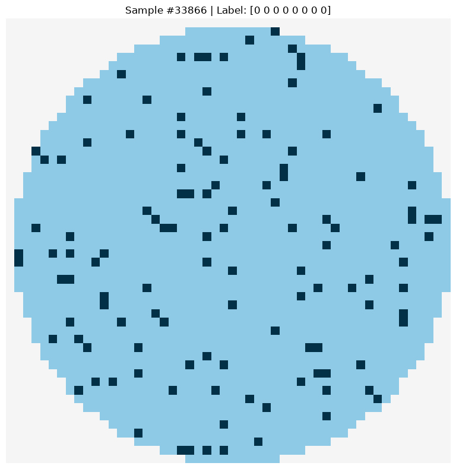
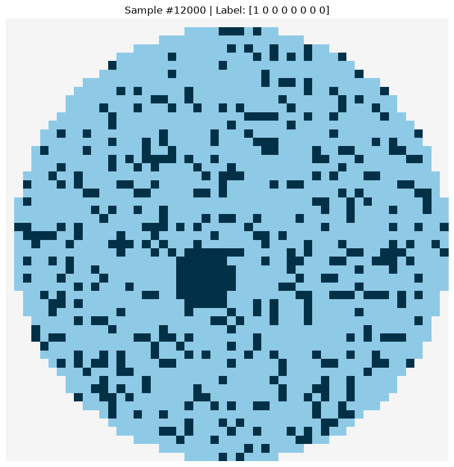
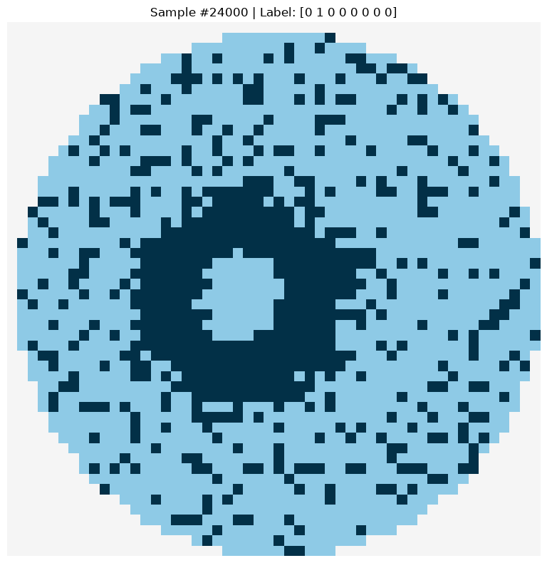
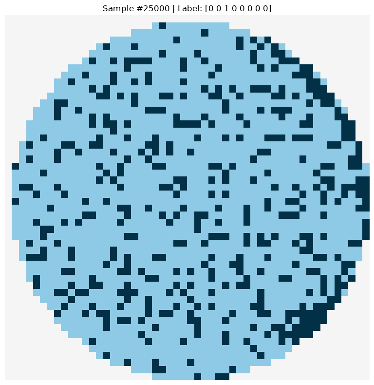
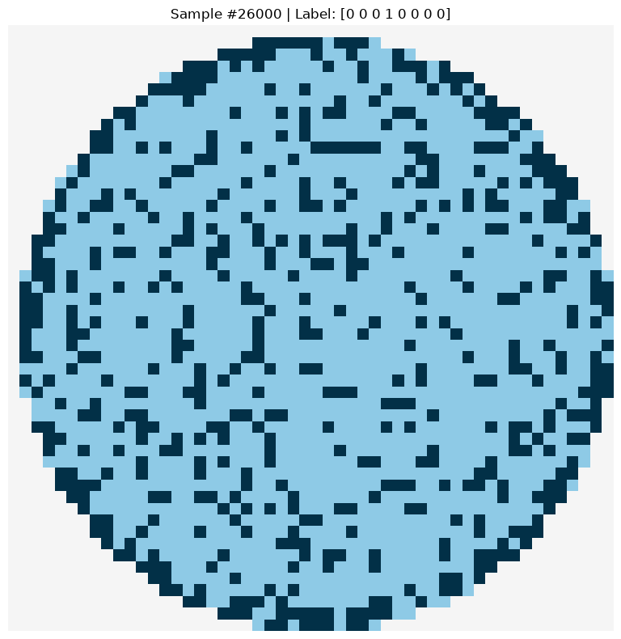
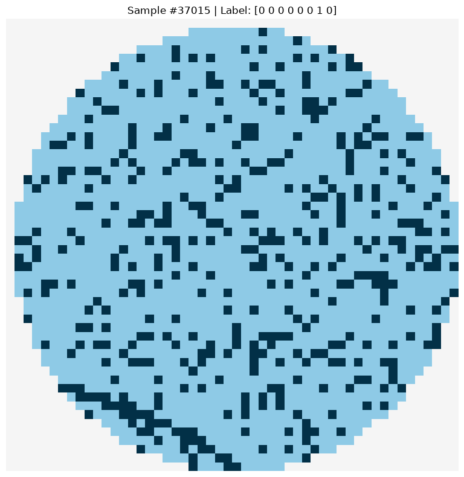
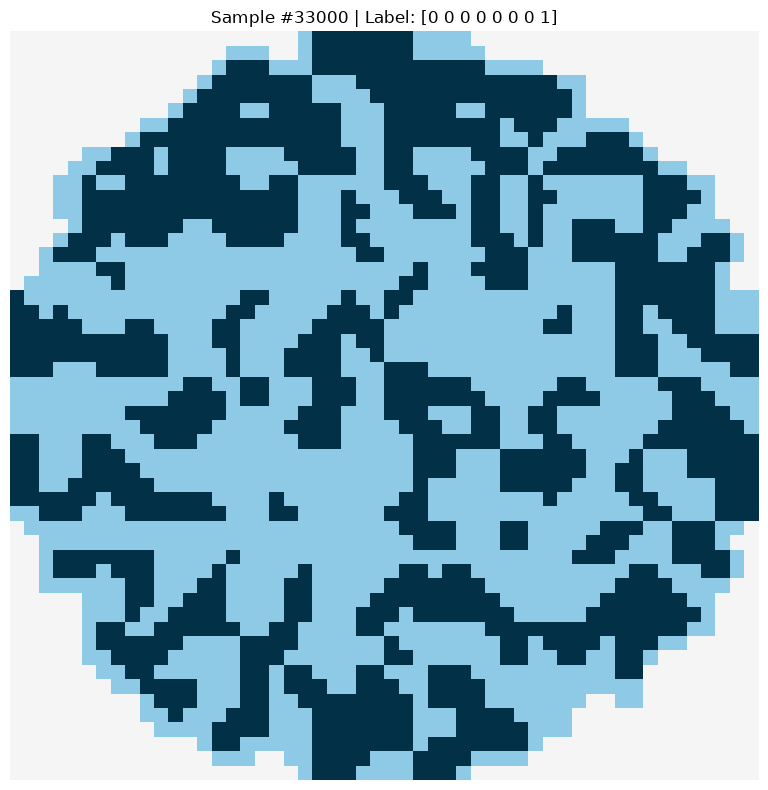

# Automated Dataset Analysis Report (EDA Report)

## Basic Information
- **File Source**: `Wafer_Map_Datasets.npz`
- **Total Samples**: `38015`
- **Image Dimension**: `(52, 52)`
- **Label Type**: `multi-label (max label per sample: 4)`

## Class Distribution
| Class | Number |
|---|---|
| Center | 13000 |
| Donut | 12000 |
| Edge_Loc | 13000 |
| Edge_Ring | 12000 |
| Loc | 18000 |
| Near_Full | 149 |
| Scratch | 19000 |
| Random | 866 |
## Label Combination Distribution
| Combination | Number |
|---|---|
| Center+Edge_Loc+Scratch | 2000 |
| Normal | 1000 |
| Scratch | 1000 |
| Loc | 1000 |
| Loc+Scratch | 1000 |
| Edge_Ring | 1000 |
| Edge_Ring+Scratch | 1000 |
| Edge_Ring+Loc | 1000 |
| Edge_Ring+Loc+Scratch | 1000 |
| Edge_Loc | 1000 |
| Edge_Loc+Scratch | 1000 |
| Edge_Loc+Loc | 1000 |
| Edge_Loc+Loc+Scratch | 1000 |
| Donut | 1000 |
| Donut+Scratch | 1000 |
| Donut+Loc | 1000 |
| Donut+Loc+Scratch | 1000 |
| Donut+Edge_Ring | 1000 |
| Donut+Edge_Ring+Scratch | 1000 |
| Donut+Edge_Ring+Loc | 1000 |
| Donut+Edge_Ring+Loc+Scratch | 1000 |
| Donut+Edge_Loc | 1000 |
| Donut+Edge_Loc+Scratch | 1000 |
| Donut+Edge_Loc+Loc | 1000 |
| Donut+Edge_Loc+Loc+Scratch | 1000 |
| Center | 1000 |
| Center+Scratch | 1000 |
| Center+Loc | 1000 |
| Center+Loc+Scratch | 1000 |
| Center+Edge_Ring | 1000 |
| Center+Edge_Ring+Scratch | 1000 |
| Center+Edge_Ring+Loc | 1000 |
| Center+Edge_Ring+Loc+Scratch | 1000 |
| Center+Edge_Loc | 1000 |
| Center+Edge_Loc+Loc | 1000 |
| Center+Edge_Loc+Loc+Scratch | 1000 |
| Random | 866 |
| Near_Full | 149 |

## Sampling Inspection
### normal

### Center

### Donut

### Edge_Loc

### Edge_Ring

### Loc

### Near_Full

### Scratch

### Random

