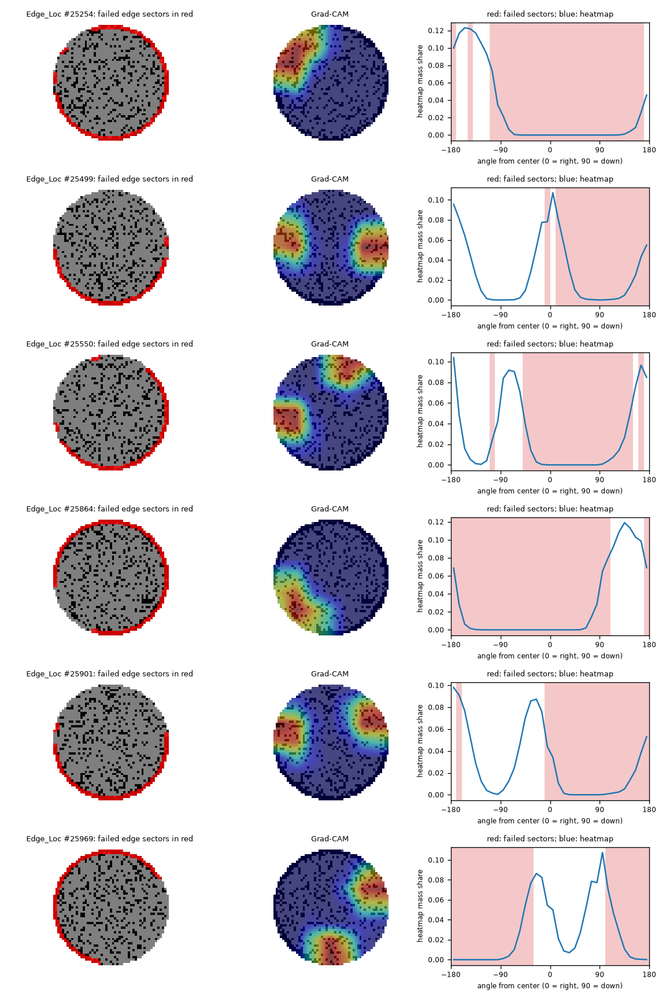
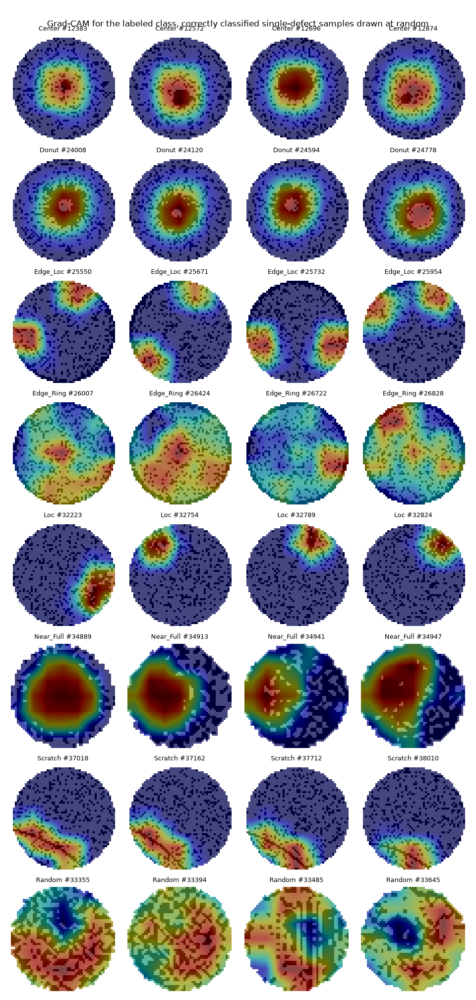
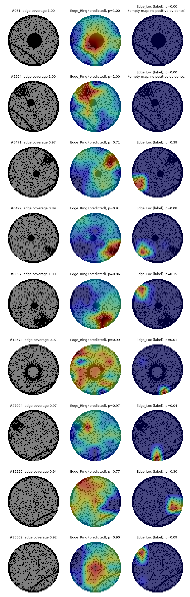

# Grad-CAM analysis

Model: MLflow run 176643c399f14d199631a45c01f3f427 (shufflenet_v2_x1_0); validation split; decisions at the run's tuned thresholds, as delivered. Heatmaps from the last convolutional block (7x7, upsampled to the input size). Code: commit `d60eec00a6ed6829496ffe8c6442a4587536f5a8`.

## Localization

For classes that lie in a known zone of the wafer (center, ring or edge, concentric zones that partition it), on every
correctly classified single-defect sample. **Mass ratio**: the share of heatmap mass in the zone divided by the zone's
share of the wafer (1 = no focus). **Pointing game**: how often the heatmap's peak falls in the zone; a point drawn at
random on the wafer would hit it as often as the zone's share of the wafer. The control is the same architecture with
random weights: its maps should not focus, nor resemble the trained model's (rank correlation near 0).

| Class | Zone | Samples | Zone share of wafer (chance) | Peak in zone, trained | Peak in zone, random weights | Mass ratio, trained | Mass ratio, random weights | Correlation with random |
|---|---|---|---|---|---|---|---|---|
| Center | center | 100 | 9% | 100% | 8% | 3.49 | 0.92 | 0.16 |
| Donut | ring | 100 | 40% | 4% | 41% | 1.49 | 1.03 | 0.13 |
| Edge_Loc | edge | 100 | 51% | 38% | 12% | 1.23 | 1.15 | 0.01 |
| Edge_Ring | edge | 100 | 51% | 26% | 0% | 0.90 | 1.29 | 0.05 |

Empty heatmaps (no positive evidence at the layer, so no peak and no mass) are left out of these figures; Edge_Ring: 0 trained, 95 random. A dash means every map was empty.

## Direction along the edge

For defects on part of the edge: the angle between where the heatmap's mass points and where the edge's failed dies lie,
seen from the wafer's center. A random direction falls within 45 degrees 25% of the time. Direction is measured
because a 7x7 heatmap resolves it well but radius only to about one cell, its peak sitting one cell inward of an edge defect.

| Class | Samples | Median angle, trained | Within 45 degrees, trained | Median angle, random weights | Within 45 degrees, random weights |
|---|---|---|---|---|---|
| Edge_Loc | 100 | 162 | 25% | 92 | 27% |

## Where along the edge the Edge_Loc heatmaps fall

The 36 edge sectors of each map are failed (most of their dies failed, as in the edge coverage) or intact; a sector
next to one of the other kind is a boundary, where failed and intact parts of the edge meet. For each kind: its share
of the heatmap mass (beyond 0.4 of the radius) divided by its share of the sectors, so 1 means no preference. A
heatmap pointing at the defect favors failed sectors; at the ends of the failed arc, boundaries; at the part of the
edge that did not fail, intact sectors. 100 usable samples (both failed and intact sectors; median
edge coverage 0.56); on average 43% of sectors are failed, 21%
boundaries and 36% intact.

| Model | Samples with a heatmap | Ratio, failed | Ratio, boundary | Ratio, intact | Most favored: failed | boundary | intact |
|---|---|---|---|---|---|---|---|
| Trained | 100 | 0.34 | 2.00 | 1.78 | 3% | 66% | 31% |
| Random weights | 100 | 1.06 | 1.03 | 1.04 | 37% | 28% | 35% |

## Examples

## Edge_Loc predicted as Edge_Ring

All 9 such samples of the validation split, with the heatmaps of the predicted and the labeled class
and the edge coverage of each map (share of the circumference with mostly failed dies; see docs/methodology.md).

